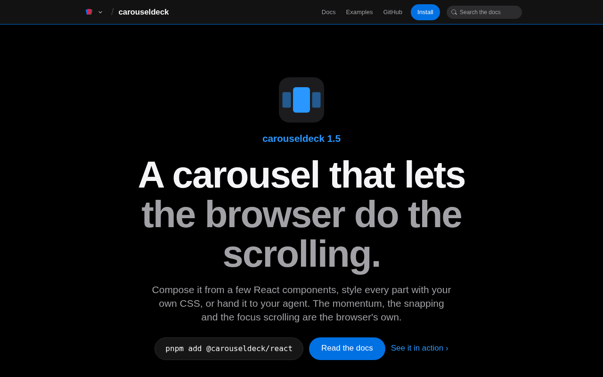

import CarouselQuickstart from "@components/demos/CarouselQuickstart";
import CarouselProgress from "@components/demos/CarouselProgress";
import CarouselFade from "@components/demos/CarouselFade";

TLDR: [carouseldeck](https://carousel.deck.cool) is a headless carousel for React 19. Most carousels move slides with transforms and their own physics. Carouseldeck uses a real scroll container with CSS scroll snap, so the browser does the scrolling and the library tracks where the deck comes to rest. It ships the accessibility and the controls, and it works with no stylesheet.

This is part 2 of the [deck.cool series](/posts/deck-cool). Carouseldeck started life as `slidedeck`.

Every carousel I looked at reimplements scrolling. It listens to pointer events, runs its own physics and moves the slides with transforms. The browser already knows how to scroll, snap and bring a focused element into view, and none of those carousels used any of it.



It was built with [Factory](https://github.com/pedrosousa13/factory), like the rest of the family. The decision records this post quotes came out of its planning sessions.

## Table of contents

## Why another carousel

Embla is good. It's about 7 KB, well built, and shadcn wraps it. Building another transform engine would mean rebuilding Embla, and I didn't think I could beat it at its own game.

So carouseldeck needed a different reason to exist. That reason is what you only get from native scrolling:

- the platform's own momentum and snapping
- scroll restoration
- scroll-driven animations
- focus and find-in-page scrolling a slide into view
- touch, trackpad, wheel and keyboard input that work the way they do on the rest of the page

The deck also keeps scrolling smoothly while the main thread is busy, and it scrolls before its JavaScript has loaded.

## Gated by a prototype

The risk was obvious from the start. Loop and mouse drag were both required for v1, and those are the two things native scrollers handle worst.

So the first decision record made the engine conditional. Before any v1 work, a throwaway prototype had to show loop, mouse drag and a fade effect working in desktop Chrome, Firefox and Safari, and on a real iPhone, under a hard flick across the loop seam. If it failed, the fallback was to wrap Embla.

The prototype passed. Playwright measured it in Chromium, Firefox and WebKit, and on my phone everything worked. Native scroll snap became the engine for good.

## Using it

```sh
pnpm add @carouseldeck/react
```

```tsx
import * as Deck from "@carouseldeck/react";

export function Featured() {
  return (
    <Deck.Root aria-label="Featured products">
      <Deck.Viewport>
        <Deck.Slide>Slide one</Deck.Slide>
        <Deck.Slide>Slide two</Deck.Slide>
        <Deck.Slide>Slide three</Deck.Slide>
      </Deck.Viewport>
      <Deck.Prev />
      <Deck.Next />
      <Deck.Dots />
      <Deck.Counter />
    </Deck.Root>
  );
}
```

That is a working deck. It has one full-width slide per snap point, Prev and Next buttons, a dot per page and a "1 / 3" counter. You style it with plain CSS. Here it is, live:

<CarouselQuickstart client:visible />

`Deck.Viewport` is the native scroll container, so scroll snap, momentum and focus scrolling all happen there, in the browser.

## Talking to CSS

Effects read the deck's state from CSS custom properties. The most useful one is progress. It measures how far a slide is from the focal position, in slides, signed in the direction the deck runs. It is 0 at the focal position, negative before it and positive after it, so 2.25 means two and a quarter slides on.

The engine writes it to `--deck-slide-progress` itself. It never goes through React state, so a scale or fade effect tied to scroll position doesn't re-render anything.

There is one rule about who owns which variables. Carouseldeck writes only `--deck-slide-*` on a slide and `--deck-viewport-*` on the viewport. The consumer sets every other `--deck-*`. Measured geometry like `--deck-viewport-step` comes through as unitless numbers, so you can divide pixels by it in `calc()`.

This deck scales each slide by its distance from the centre. The whole effect is one CSS rule:

```css
[data-carouseldeck-slide] {
  scale: calc(1 - min(abs(var(--deck-slide-progress, 0)), 1) * 0.2);
}
```

<CarouselProgress client:visible />

Effects can also change how slides are laid out. The fade effect stacks the slides in one place and crossfades them. It's still a scroll container underneath, so a swipe still moves it, and this one loops:

<CarouselFade client:visible />

## The hard parts

Letting the browser scroll gives you a lot for free. It also means working around a scroll container that was never designed to be a carousel.

**`scrollend` can't be trusted alone.** In Chromium, if a new move starts right as the previous one ends, the late `scrollend` and `scrollsnapchange` of the old scroll arrive after the new move has started. The new move then gets no end event of its own. So an end event cannot tell you which move it ends, and the engine has to track each move's lifecycle itself.

**Looping.** The first version used clone and jump. It rendered a full set of inert, `aria-hidden` copies on each side and jumped one set length back once the viewport came to rest on a copy. That broke on an iPhone. Swipes chained faster than the deck could settle turned into one long scroll with no rest point to jump at, so the deck ran off the end of its copies. Later I decided each slide should mount exactly once, with no lighter copies. The current loop places the one real slide over empty snap targets with a translate, so refs, state, effects and media stay stable across the seam.

**WebKit settling short.** Decks would sometimes settle one snap point short in Safari. The fix was to wait for a rendered frame before ending a move early or snapping it again.

**An autoplay race under load.** A step that fell due after the pointer entered the deck, but before the render that pauses autoplay, would still run. React handles pointer enter and leave on a later render, so the window was real, and it got wider under load. The step now checks the pointer and the document's visibility itself.

**Vertical and right-to-left.** Orientation is a prop. Writing direction is read from CSS, so a deck in a right-to-left document starts at the right and Next moves left. Everything that reads or writes a scroll position goes through one axis helper, which keeps snap points, drag and paging correct on either axis.

## Accessibility you don't have to add

Embla and Keen give you an engine, and the markup, controls and accessibility are yours to write. Carouseldeck ships them:

- `Deck.Root` is a region with `aria-roledescription="carousel"`, named by your `aria-label`.
- Each slide is a group labelled "n of m".
- Prev, Next, the dots and the autoplay toggle are native buttons with names.
- A polite live region announces "Slide n of m" after moves the user makes, but not while autoplay rotates the deck.
- No slide is hidden or `inert` for being off-screen. Tabbing into one scrolls it into view natively, and snap settles it.
- Under reduced motion, moves jump instead of scrolling smoothly, and autoplay starts stopped.

The dots are a labelled group of buttons with `aria-current`, not tabs. The APG pattern offers a tabbed variant, but with several slides in view a dot stands for a page, not a single slide. The tabs pattern would describe a relationship that isn't there.

## Tradeoffs

Carouseldeck is bigger. The README's comparison table is generated by a script, and CI fails when it goes stale:

| Library                | Min+gzip | Native scroll                     |
| ---------------------- | -------- | --------------------------------- |
| `@carouseldeck/react`  | 12.90 KB | Yes, CSS scroll snap              |
| `embla-carousel-react` | 7.61 KB  | No, `translate3d` and own physics |
| `keen-slider`          | 6.61 KB  | No, `translate3d` and own physics |

That's about 5 KB more than Embla and 6 KB more than Keen. The extra bytes are the accessibility, the controls and server HTML that is correct before hydration. I watch bundle size, but it was never a gate. The build prints the sizes and never fails on them.

## Testing it

Most carousel bugs only show up in one engine under one input, so the gate runs everywhere. Vitest runs in browser mode on React 18 and 19. Playwright runs with axe against Storybook in Chromium, Firefox and WebKit. A Next.js server component renders a deck from the packed tarballs.

One rule from code review stuck. A new test has to fail without the change it covers, and the PR has to show it. Three reviews in a row found tests that passed either way.

## How Factory built it

carouseldeck started as `slidedeck`, a [Factory](https://github.com/pedrosousa13/factory) project from its first commit. The first planning session produced three milestones, and the first one wasn't code at all:

- **M0 Engine decision** (4 issues): the prototype gate. Build a throwaway native-scroll carousel, measure it in three browser engines and on a real iPhone, and decide whether to keep going or wrap Embla instead.
- **M1 v1** (44 issues): the engine, the primitives, loop, drag, fade, accessibility.
- **M2 Site** (14 issues): the docs and the first site.

Since moving into the deck.cool repo, another 47 issues have closed under the `slide.deck.cool` milestone. The loop never got to decide the engine itself. That milestone ended in a decision I made, recorded in an ADR, and only then did v1 issues become `ready-for-agent`.

## What's next

Part 3 takes the same idea to a bottom sheet. Drawerdeck lets the browser do the dragging, and `<dialog>` does the rest.

## Try it

- [Docs and live demos](https://carousel.deck.cool)
- [npm: @carouseldeck/react](https://www.npmjs.com/package/@carouseldeck/react)
- [Source](https://github.com/pedrosousa13/deck-cool/tree/main/decks/carouseldeck)
