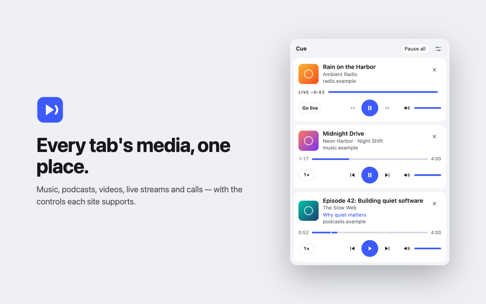
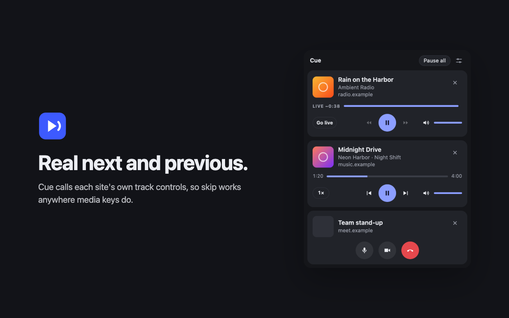
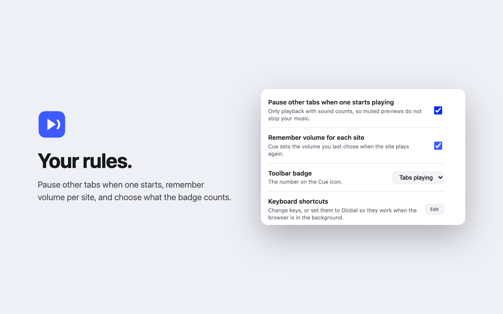

TLDR: [Cue](https://chromewebstore.google.com/detail/ggogjhkfogjdnjpnephdkekfckfddmge) is a Chrome extension that lists every tab playing audio or video and lets you control each one from the toolbar or the side panel. It works in Chrome, Brave, Edge, Vivaldi and other Chromium browsers. Next and previous call the site's own track handlers, the same ones your keyboard media keys use, so they work on any site that supports media keys with no per-site code. Cue doesn't poll your tabs and collects no data.

I built it because Vivaldi has no global media controls. Chrome has a toolbar button that lists every tab playing media and lets you pause any of them. Vivaldi doesn't. Cue is that button, for any Chromium browser, plus a side panel.



## Table of contents

## What it does

One card per tab, with title, artist, artwork and site. Playing tabs come first. From the card you can:

- play, pause and seek without switching tabs
- skip tracks with the site's real next and previous
- set the volume per tab, and Cue remembers it per site
- change playback speed, or open picture-in-picture
- pause everything at once

There are keyboard shortcuts for play/pause, next, previous and mute, and you can set them to global so they work while the browser is in the background. There's an optional auto-pause too. When a tab starts playing with sound, every other tab pauses.

## No polling

Most media panels inject a script into each tab and read the player once a second. Cue works the other way around.

1. A small script in each page listens for media events: play, pause, seek, track change. It sends a message only when something changes.
2. The service worker keeps the list in `chrome.storage.session`.
3. The panel reads that list and advances the clock itself between updates.

When nothing is playing, Cue does no periodic work. When something is playing, each tab sends a few messages per track, not one per second.

The page script batches events, because a track change fires `loadedmetadata`, `durationchange`, `seeked` and `play` within a few milliseconds and that should be one message. While playing, it checks the clock every 2 seconds, but it only sends a message if the panel's estimate has drifted from the page by more than three quarters of a second. Most checks cost a comparison, not a message.

The clock also stops while the player buffers. A buffering player still reports "playing", but no sound is coming out, so the panel advances the clock only when the media element has data to play.

## Borrowing the site's own buttons

Next and previous are the interesting part. A web page can't tell an extension how to skip a track. But sites that support media keys register handlers with the Media Session API, and Chrome's own media hub calls those handlers directly.

So Cue does the same. Its page script runs in the page's own JavaScript world and wraps `MediaSession.prototype.setActionHandler`:

```js
proto.setActionHandler = like(function (action, handler) {
  const result = setActionHandler.call(this, action, handler);
  if (typeof handler === "function") handlers.set(action, handler);
  else handlers.delete(action);
  schedule();
  return result;
}, setActionHandler);
```

The wrapper calls the original, returns its result, and keeps the native function's name and length. Cue now holds the same handlers the media keys would call. That works on any site that supports media keys, with no per-site selectors. When a site has no track handlers, the buttons skip 10 seconds instead.

The same trick covers more than tracks. Wrapping `setPositionState` gives Cue the site's own clock. Wrapping `setMicrophoneActive` and `setCameraActive` means call sites like Google Meet get a card with microphone, camera and hang-up buttons.



## Which tabs get a card

Chrome's own media controls list a tab only after it plays with sound. That means not muted, volume above 0, an audio track, and at least 5 seconds long. Shorter clips are notification sounds. Cue uses the same rule, so a muted background video or a click sound gets no card. Once a tab has been heard, it keeps its card, even if you mute or pause it.

When a site publishes no metadata, Cue looks around the media element. On Reddit it reads the post title and subreddit. On other sites it uses the enclosing article's heading, and the video's poster becomes the artwork. Each detail has a fallback chain. The title, for example, goes from the Reddit post title to the article heading, the element label, `og:title`, the tab title and finally the host name.

## YouTube is special

YouTube and YouTube Music play their whole autoplay queue through one media element, so the element's clock covers the queue, not the track. When a site doesn't publish a clock with `setPositionState()`, Cue reads the track clock from YouTube's player instead. It uses the seekable window, not the player's duration, which counts what has buffered and grows while the track loads. I got that approach from [vivaldi-media-panel](https://github.com/levz0r/vivaldi-media-panel).

Volume goes through YouTube's player too. Otherwise YouTube reapplies its own volume over the element's.

During an ad, the card shows "Ad" and seeking is off. When YouTube shows its Skip button, Cue's Skip ad presses it, and only when you click. Finding that button has a fallback chain of its own. Cue tries the site's `skipad` handler, then the known class names, then any button in the ad area whose class contains "skip". It never matches the button text, because the text changes with the language. One of the tests renames the Skip button to check the last fallback.

## Live streams

A stream counts as live when the element reports an infinite duration, when the site says so through `setPositionState()`, when YouTube's player says so, or when the duration is longer than about 11 days. That last check is there because live players often report placeholder durations of years. YouTube reported 121,601,512 seconds when I measured it.

At the live edge, the card shows `LIVE`. Pause or fall behind and it shows how far, like `LIVE −0:42`, plus a Go live button.

## It doesn't trust the page

Cue's page script runs in the page's own world, which means the page can talk back. A page can dispatch Cue's events itself and send anything at all. So the service worker treats every message as hostile:

- it keeps only known fields with the expected types, and truncates long strings
- the host name on a card comes from the browser, not the page, so a page can't label its card as another site
- a tab gets at most 16 frames, so a page can't fill storage with iframes
- the relay sends at most one message per 200 ms per frame
- auto-pause triggers at most once every 2 seconds per tab, so a page that toggles playback in a loop can't keep pausing everything else
- plain-http artwork loads only from the page's own host, so a page can't make Cue fetch arbitrary addresses for it

Artwork is fetched without cookies and without a referrer, then shown from a `blob:` URL. An `` in an extension page would otherwise send your cookies for that site, with a URL the page chose.

## Privacy

Cue collects no data. Its only network requests download artwork. Playback state lives in `chrome.storage.session`, which the browser deletes when it closes.

Three things persist. Your settings, the volume you chose for each site, and the popup's height. The per-site volume is a host name and a number, and it stays on your device. Cue writes no titles to disk, and a test checks that.

The permissions are short: `storage`, `scripting` and `sidePanel`, plus access to all sites. Cue needs that last one because media can play on any site, and it uses it only to read playback state and send the controls you click.



## Tradeoffs

- **Cue wraps built-in page functions.** There is no other way for an extension to get a site's Media Session handlers. The wrappers keep their native names and lengths, but a site that checks `toString()` can still detect them.
- **Some audio is invisible.** Cue can't see media inside closed shadow roots, or sound made only with the Web Audio API. When the browser marks a tab audible and Cue knows nothing in it, Cue searches open shadow roots, at most once a minute.
- **The clock depends on the site.** A site that plays a queue through one element and publishes no clock can show the wrong time after autoplay. YouTube is handled, but other sites like it may not be.
- **YouTube support can break.** Ad detection reads YouTube's player and page. If YouTube changes them, it stops working until Cue is updated.

## Testing it

`npm test` loads the extension into Playwright's Chromium, opens local test pages that play generated audio and video, and drives Cue through its real panel. It covers the features and the hostile cases, like oversized fields, iframe floods, a page trying to catch the picture-in-picture click, forged host names. The tests use local pages only, never real sites.

The extension has no build step and no runtime dependencies. Playwright is only used for tests, the icons and the store screenshots, which are rendered from the real extension.

## Try it

- [Chrome Web Store](https://chromewebstore.google.com/detail/ggogjhkfogjdnjpnephdkekfckfddmge)
- [GitHub](https://github.com/pedrosousa13/cue)

In Vivaldi, you can also add Cue as a web panel with the URL `chrome-extension://<id>/panel.html`. You'll find the id on `vivaldi://extensions`.
