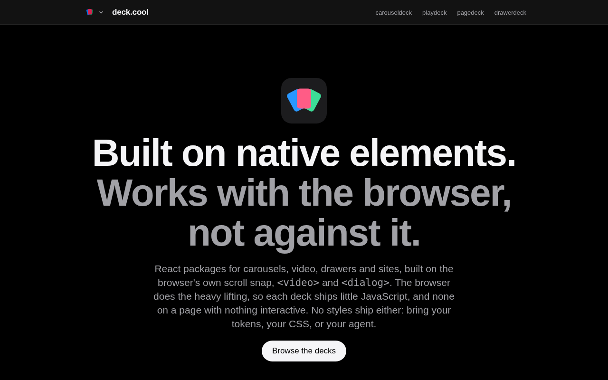

TLDR: [deck.cool](https://deck.cool) is a family of small, unstyled React components that work with the browser instead of around it. The carousel scrolls with native scroll snap. The drawer drags with native scrolling and opens as a real `<dialog>`. The video player wraps `<video>` and each provider's own SDK, and hides any control the provider can't honour. On the side, there's Pagedeck, a static-site framework that works like Astro, but built for React.

This is part 1 of a series. It covers the idea, how a deck works inside, what it costs you, and where it fits next to the libraries you already know. Parts 2 to 5 cover one deck each, with live demos in the post.



## Table of contents

## The family

Three components:

| Deck         | What it is                                        | Built on                                                  |
| ------------ | ------------------------------------------------- | --------------------------------------------------------- |
| carouseldeck | A carousel that lets the browser do the scrolling | A scroll container with CSS scroll snap                   |
| drawerdeck   | A drawer that lets the browser do the dragging    | Scroll snap again, inside a `<dialog>`                    |
| playdeck     | A video player you compose, not one you configure | `<video>`, hls.js, and the YouTube, Vimeo and Wistia SDKs |

And one extra:

| Deck     | What it is                                                    | Built on                                           |
| -------- | ------------------------------------------------------------- | -------------------------------------------------- |
| pagedeck | A static-site framework, like Astro if it were made for React | React's server renderer, SQLite and `"use client"` |

Pagedeck is a different kind of thing. It isn't a component. It's what every deck.cool site is built with, and it follows the same rule at page scale: plain HTML first, and JavaScript only where a page needs it.

## Where it came from

Playdeck came first, out of frustration with video players in React. Then carousels. Most of them reimplement scrolling in JavaScript, when the browser already has scroll snap, momentum and focus scrolling built in. Drawers do the same, and they also rebuild what `<dialog>` already gives you.

Pagedeck came from a different itch. I wanted Astro, but built for React marketing sites.

All four were built with [Factory](https://github.com/pedrosousa13/factory), my Claude Code loop: I plan the work into issues, and an agent session implements, reviews and merges them one at a time. Across the deck repos that's over 1,200 merged pull requests, and the decision records and glossaries this series quotes come out of that process. Factory gets its own post at the end of the series.

## The idea: the native element is the engine

Every deck starts with one question: what does the platform already do here?

For a carousel, the answer is almost everything. A scroll container already handles touch, trackpad, wheel and keyboard input. It already has momentum, and CSS scroll snap already decides where it comes to rest. Tabbing to a link inside an off-screen slide already scrolls it into view. So carouseldeck doesn't move slides. It lets the browser scroll, watches where the deck rests, and asks the browser to move when you press Next.

For a drawer, it's the same scroll container turned on its side, plus `<dialog>`. `showModal()` gives you the top layer, a focus trap, an inert page behind and Escape. There's no portal.

For video, the platform is `<video>` plus each provider's SDK. The deck's job is to be honest about what each one can do.

There's one rule that keeps this from becoming dogma. An input stays native unless a benchmark shows it can't reach its target. When one can't, only that input falls back to JavaScript, never the whole engine. A mouse can't drag a scroll container, for example, so mouse drag gets a pointer handler in both the carousel and the drawer. Touch, wheel, trackpad and keyboard stay native.

## What that buys you

- **It stays smooth when the page is busy.** The browser scrolls on its own thread. Under a heavy load, drawerdeck dropped no frames in its benchmark, where the JavaScript-driven drawers dropped about half.
- **It works before hydration.** A carousel is a scroll container in the server HTML, so it scrolls before its JavaScript has loaded.
- **Input and accessibility come with it.** Scrolling with any device, focus scrolling, find-in-page and the dialog's focus rules are the browser's, and the browser gets them right.
- **There's less code to ship and maintain.** No physics engine, no focus trap, no portal.

## How a deck works inside

Each component deck has the same layers:

```
your markup and CSS
   ▲  data-* attributes, --deck-* / --drawer-* custom properties
React primitives      @carouseldeck/react, @drawerdeck/react, @playdeck/react
   ▲  compose: Root, Viewport, Slide, Trigger, Panel, PlayButton…
framework-neutral core   measures, tracks state, asks the browser to move
   ▲
the native element    scroll container · <dialog> · <video> + provider SDK
```

**The core is framework-neutral.** `@carouseldeck/core`, `@drawerdeck/core` and `@playdeck/core` hold the engine and know nothing about React. The React package is a thin layer of primitives on top, and it's the only one you install.

**You compose primitives.** `Deck.Root`, `Deck.Viewport`, `Deck.Slide` and `Deck.Next`, or `Drawer.Trigger`, `Drawer.Panel` and `Drawer.Handle`. Each renders one element you can style, and a primitive you leave out isn't rendered.

**State comes out as attributes and CSS variables.** The current slide is `data-current`, and a drawer's phase is `data-phase="opening"`. Continuous values, like how far a slide is from the centre (`--deck-slide-progress`) or how open a drawer is (`--drawer-progress`), go to CSS custom properties. The engine writes them directly, never through React state, so a scroll-linked effect re-renders nothing.

**Structure ships, looks don't.** Anything that would make a deck broken without a stylesheet, like playdeck's overlays stacking, is set inline. Everything visual is yours.

**The server HTML is correct.** A deck renders real markup on the server, with the right labels and roles, so it's usable before hydration and readable by crawlers.

## What it costs you

None of this is free, and I'd rather say so than have you find out:

- **Sometimes more bytes than an engine.** carouseldeck is 12.90 KB min+gzip against Embla's 7.61 KB. Embla gives you an engine, and the markup, controls and accessibility are yours to write. carouseldeck ships those. Whether that's a win depends on whether you'd write them anyway.
- **Less control over physics.** The browser owns momentum and snapping. If you want a custom spring curve on every flick, a transform-based carousel will give you that, and this won't.
- **Platform gaps are your gaps.** Firefox doesn't support scroll-driven animations yet, so the drawer's dim falls back to a custom property written on scroll there. Mouse drag is JavaScript everywhere.
- **You style everything.** Headless is the point, but it means there's no theme to drop in.
- **React only, and mostly React 19.** carouseldeck and drawerdeck also ship React 18 builds. Playdeck needs 19.
- **Young, and one maintainer.** drawerdeck is a beta. The others are past 1.0, but they're still mine alone.

## Where it fits

There are roughly four kinds of library for this work:

| Kind                | Examples                           | You get                                                                                | You write                               |
| ------------------- | ---------------------------------- | -------------------------------------------------------------------------------------- | --------------------------------------- |
| Styled kits         | Swiper, MUI                        | Everything, in their look                                                              | Overrides to make it yours              |
| Broad headless sets | Radix, Base UI, React Aria         | Dozens of primitives, behaviour driven by JavaScript                                   | Styles                                  |
| Engines             | Embla, Keen                        | Movement and an API                                                                    | Markup, controls, accessibility, styles |
| deck.cool           | carouseldeck, drawerdeck, playdeck | A few primitives where a native element is the engine, with controls and accessibility | Styles                                  |

deck.cool isn't trying to be a full component library. It covers the few components where the platform can do most of the work and the usual libraries don't let it: a carousel, a drawer and a video player.

So it sits next to whatever you already use. Keep Radix or Base UI for menus, popovers and selects. Use a deck where you'd otherwise reach for Embla, vaul or a player wrapper. It fits a shadcn-style setup well, where you already own your styles and want unstyled parts that behave correctly.

## No styles

None of the packages ships CSS. You style the primitives with your own tokens, your own CSS, or your agent.

That last one is deliberate. I wrote the sites for three audiences equally: developers who install a deck, designers who decide how it looks, and people coding with an AI agent. A small set of primitives with clear names is easy for an agent to work with too.

## Claims need a test

Every accessibility claim on a deck's site points to a test in that deck's repo. A claim with no test stays off the page, and the gap gets filed as an issue.

The numbers work the same way. Each deck's site leads with one figure. carouseldeck has its bundle size. playdeck makes zero requests to YouTube or Vimeo before you press play. drawerdeck has zero third-party libraries driving the drag, and pagedeck ships zero bytes of JavaScript on a page with nothing interactive. carouseldeck's comparison table comes from a script, and CI fails when it goes stale. drawerdeck's benchmark reruns in CI before every release.

## How the family is run

Every deck.cool site is built with Pagedeck and deploys to Cloudflare, one subdomain per deck. They share a brand kit: the favicons, a dark palette, one motion curve, and the family bar at the top, whose switcher is CSS popovers with no JavaScript.

Each deck publishes its reference docs to npm as plain markdown, at the same version as its code. The site renders them under `/docs`, and a comment in the markdown marks where a live demo goes. The docs always describe the latest release, and the deck owns its words while the site owns how they look.

The decks started in separate repos under other names. carouseldeck was `slidedeck`, playdeck was Reely, and pagedeck was a project called "framework". The deck.cool repo is becoming the monorepo for all of them. carouseldeck moved in first, drawerdeck was born there, and playdeck and pagedeck follow their releases through an automated bump PR.

## How Factory built it

Every deck in this series was built with [Factory](https://github.com/pedrosousa13/factory). The deck.cool repo has a milestone per site (foundation, deck.cool, slide.deck.cool, page.deck.cool, play.deck.cool and drawer.deck.cool), and each deck that lives outside it has its own repo, milestones and issue queue.

Each part of this series ends with how Factory built that deck: the prototype gate behind carouseldeck, the map that planned drawerdeck, playdeck's seven security sweeps, and the issues Pagedeck has parked waiting for me.

## What's next

Part 2 is carouseldeck: why a carousel should let the browser scroll, what broke when it did, and a few live decks to swipe through.

## Try them

- [deck.cool](https://deck.cool)
- [carouseldeck](https://carousel.deck.cool), `pnpm add @carouseldeck/react`
- [drawerdeck](https://drawer.deck.cool), `pnpm add @drawerdeck/react@beta`
- [playdeck](https://play.deck.cool), `pnpm add @playdeck/react`
- [pagedeck](https://page.deck.cool), `npm create pagedeck@latest`
