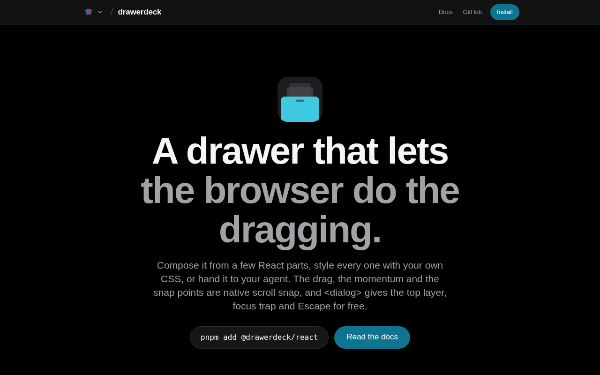

import DrawerQuickstart from "@components/demos/DrawerQuickstart";
import BarChart from "@components/BarChart.astro";

TLDR: [drawerdeck](https://drawer.deck.cool) is an unstyled React drawer, the bottom-sheet kind. Other drawers drive the drag from JavaScript on every pointer move. In drawerdeck, the sheet sits in a scroll-snap container, so the browser drags it, flings it and settles it. `<dialog>` handles the top layer, the focus trap and Escape, with no portal. It is 8.99 KB min+gzip and in beta.

This is part 3 of the [deck.cool series](/posts/deck-cool). Drawerdeck is the newest deck, and it uses the same idea as [carouseldeck](/posts/carouseldeck): let the browser scroll.

Drawers have a second problem on top of the JavaScript drag. They rebuild what `<dialog>` already gives you. They portal the sheet to the end of the body, trap focus by hand, make the page behind inert and listen for Escape. The browser does all of that for a modal dialog.



Like the rest of the family, it was built with [Factory](https://github.com/pedrosousa13/factory). It went from an empty package to a published beta in about a day.

## Table of contents

## The problem with JavaScript drags

vaul is the drawer most people reach for, and it is unmaintained. Its last release was 1.1.2, in December 2024. Base UI's Drawer is the maintained alternative.

Both drive the drag from the main thread. vaul writes a `translate3d` on every pointer move. Base UI writes a CSS variable from `onPointerMove`, and it listens for `touchmove` on the whole document to call `preventDefault()`.

That works when the page is idle. When the main thread is busy, the drag waits on it.

## Native scrolling as the engine

In drawerdeck, closed, half and full are snap points in a scroll container. Dragging the sheet is scrolling, so touch, wheel and trackpad input, momentum and settling all come from the browser.

The first decision record set a rule. An input stays native unless a benchmark shows it can't reach a target. Even then, only that input falls back, never the whole engine. So far that has happened exactly once. A mouse can't drag a scroll container, so mouse drag gets a pointer handler with a projected throw.

`Drawer.Popup` renders a `<dialog>` and opens it with `showModal()`. That gives you the top layer, focus trapping, an inert page behind it and Escape, all from the platform.

## Using it

```sh
pnpm add @drawerdeck/react@beta
```

```tsx
import * as Drawer from "@drawerdeck/react";

export function Settings() {
  return (
    <Drawer.Root>
      <Drawer.Trigger>Open</Drawer.Trigger>
      <Drawer.Popup>
        <Drawer.Backdrop />
        <Drawer.Viewport>
          <Drawer.Panel>
            <Drawer.Handle />
            <Drawer.Title>Settings</Drawer.Title>
            <Drawer.Content>…</Drawer.Content>
            <Drawer.Close>Done</Drawer.Close>
          </Drawer.Panel>
        </Drawer.Viewport>
      </Drawer.Popup>
    </Drawer.Root>
  );
}
```

With no `snapPoints`, the drawer has one open point, the panel at its content height, capped by its own CSS `max-height`. Pass `snapPoints={[0.5, 1]}` for half and full. `Drawer.Content` stays locked until the top snap point, so scrolling inside it doesn't fight the sheet.

Here it is with those two snap points. Open it, drag it between half and full, flick it closed or press Escape:

<DrawerQuickstart client:visible />

The published beta is bottom-only and modal-only. On main, the drawer can also open from the top, left or right, be non-modal, nest inside another drawer and indent the page behind it. Those land in the next beta.

## The dim runs on a scroll timeline

The backdrop darkens as the sheet rises. In most drawers that's JavaScript writing an opacity every frame.

Here, `Drawer.Viewport` carries a named scroll timeline, `--drawer`, and the dialog carries `timeline-scope: --drawer`, so the backdrop can animate off it even though it sits outside the viewport. Give `Drawer.Backdrop` a class and drive your own keyframes from the timeline:

```css
@supports (animation-timeline: scroll()) {
  @keyframes dim {
    from {
      background-color: rgb(0 0 0 / 0);
    }
    to {
      background-color: rgb(0 0 0 / 0.5);
    }
  }

  .backdrop {
    background-color: rgb(0 0 0 / 0);
    animation: dim 1s linear;
    animation-timeline: --drawer;
    animation-range: 0 var(--drawer-first-snap);
    animation-fill-mode: both;
  }
}
```

Chromium and Safari run that natively. Firefox doesn't support scroll-driven animations yet, so it falls back to a `--drawer-progress` custom property.

## Things the prototype got wrong

I built a throwaway prototype before the real engine, and a few of its findings turned into fixes:

- `showModal()` focuses the first focusable descendant. If that's an input under 16px, iOS zooms the page. So the dialog takes the initial focus itself.
- A viewport resize during the opening scroll would snap the sheet back to closed. Opening became its own phase, and dismissal is impossible during it.
- The prototype concluded that a scroll timeline can't reach across the top layer, so a background indent would need JavaScript. That's the effect where the page scales back behind the sheet.

That last one turned out to be wrong. The real cause was re-declaring the timeline name inside the dialog, which isolates it. A second named timeline on the viewport, scoped on `documentElement` instead, reaches the page behind. The indent shipped as CSS, opt-in through an `indent` prop.

## The on-screen keyboard

This was the hardest part, and every drawer I looked at struggles with it.

When a field inside the drawer gets focus and the keyboard opens, drawerdeck moves to its largest snap point, the same as a native iOS sheet. It then scrolls `Drawer.Content` so the field sits clear of the keyboard, measured against the real visible window. That's on by default, on main.

iOS Safari has its own reaction to focus. It pans the whole page to centre the field. Since the drawer is `position: fixed`, the pan can push its top edge off the screen. A real iPhone test showed my first fix was unreliable. The same build passed once and failed once. In the failing run, Safari's pan never settled, and the form stayed above the screen.

I looked at how the others handle it. Base UI intercepts touch events to stop the pan before it starts. React Aria overrides `HTMLElement.prototype.focus` globally. Both work, but I didn't want drawerdeck patching focus for the whole page. The smaller fix grows `padding-top` on `Drawer.Content` so the field stays reachable inside the existing shape. The regression test replays both iPhone runs. The failing replay failed on main before the fix and passes after it, in Chromium and WebKit.

## The benchmark

The docs have a comparison page against vaul, Base UI's Drawer and React Aria's Sheet. The numbers come from a CI benchmark of drawerdeck's main branch. It runs all four on the same runner, interleaved and sharded, with production builds, each library configured the way its own docs recommend.

<BarChart
  title="Dropped frames during a drag, heavy load (200 ms busy tick)"
  unit="%"
  max={60}
  rows={[
    { label: "drawerdeck", value: 0, valueLabel: "0.0%", highlight: true },
    { label: "Base UI", value: 47.9 },
    { label: "React Aria", value: 54.1 },
    { label: "vaul", value: 55.3 },
  ]}
  caption="From drawerdeck's CI benchmark. Lower is better."
/>

<BarChart
  title="Bundle size, min+gzip, React excluded"
  unit=" KB"
  decimals={2}
  rows={[
    { label: "drawerdeck", value: 8.99, highlight: true },
    { label: "vaul", value: 22.58 },
    { label: "React Aria Sheet", value: 30.69 },
    { label: "Base UI Drawer", value: 30.92 },
  ]}
/>

The full numbers:

|                              | drawerdeck | vaul          | Base UI       | React Aria    |
| ---------------------------- | ---------- | ------------- | ------------- | ------------- |
| Bundle (min+gzip)            | 8.99 KB    | 22.58 KB      | 30.92 KB      | 30.69 KB      |
| Dropped frames, medium load  | 0.0%       | 25.6%         | 16.6%         | 29.3%         |
| Dropped frames, heavy load   | 0.0%       | 55.3%         | 47.9%         | 54.1%         |
| Flick to dismiss, heavy load | closes     | did not close | did not close | did not close |

Under load, drawerdeck drops no frames because the browser keeps scrolling while the main thread is busy. That's the whole bet. Longest stall and open-to-half come out as ties. A row only counts as a win when every shard agrees and the gap is bigger than the leader's own spread.

One fix to the benchmark made drawerdeck look slightly worse. The longest-stall metric scored each frame on when it started, not when it was shown. Under a busy main thread those can be hundreds of milliseconds apart, so the metric had been crediting all four libraries for frames they hadn't shown yet. Rescored, the rivals' numbers moved up more than drawerdeck's, but it was still a fix to my own measuring stick. The CI benchmark now gates the claims on the site, and it reruns before every release.

## Tradeoffs

- **It's a beta.** The API can still change.
- **Mouse drag is JavaScript.** A mouse can't drag a scroll container.
- **Firefox gets the fallback.** No scroll-driven animations there yet, so the dim and indent use a custom property written on scroll.
- **Non-modal drawers leave the top layer.** `modal={false}` opens the dialog with `show()` instead. Neither vaul nor Base UI uses the top layer at all, so that's a narrower gap than theirs.

## How Factory built it

drawerdeck is the clearest example of how [Factory](https://github.com/pedrosousa13/factory) handles something too foggy to plan in one go. It started as a map, a planning issue that charts an effort before any of it becomes work. The map broke "build a drawer on native scrolling" into research and prototype issues, each answering one question:

- propose the composable primitives (#234)
- find each native feature's support and fallback (#236)
- prototype the other sides, non-modal and nested drawers (#237)
- keep the drawer steady when the on-screen keyboard opens (#238)
- settle a mouse-drag release as fast as the rivals (#235), and find a 500 ms stall in a touch drag (#243)

Each answer turned into ordinary `ready-for-agent` issues, and the loop built them: 51 closed under the `drawer.deck.cool` milestone so far, from an empty package to a published beta in about a day. The iPhone keyboard fix in this post started the same way, with a pull request that passed in CI and then failed on a real iPhone.

## What's next

Part 4 is playdeck, the video player that started the family, and the one that hides every control the provider underneath can't honour.

## Try it

- [Docs](https://drawer.deck.cool/docs)
- [Comparison with vaul, Base UI and React Aria](https://drawer.deck.cool/docs/compare/)
- [npm: @drawerdeck/react](https://www.npmjs.com/package/@drawerdeck/react)
- [Source](https://github.com/pedrosousa13/deck-cool/tree/main/decks/drawerdeck)
