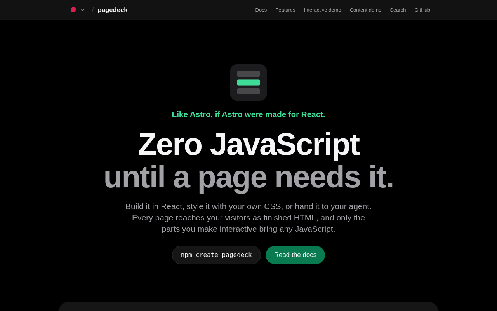

import BarChart from "@components/BarChart.astro";

TLDR: [Pagedeck](https://page.deck.cool) is a static-site framework for CMS-driven React sites. `pagedeck sync` reads your content through a loader into a SQLite store. `pagedeck build` renders every page to HTML and bundles JavaScript only for components whose module starts with `"use client"`, and only on the pages that render them. Content pages ship 0 bytes of JavaScript, and you never write a per-page or per-usage annotation.

This is the last part of the [deck.cool series](/posts/deck-cool). The other decks are components. Pagedeck is the extra: a framework, and the thing every deck.cool site is built with.

The short version of why it exists: I wanted Astro, but built for React marketing sites from the start. Astro gets the output right. Writing a CMS-driven React site in it means wrappers and per-usage hydration directives.



It was built with [Factory](https://github.com/pedrosousa13/factory) from its first day, as framework, then as Pagedeck: almost 500 merged pull requests between the two repos.

## Table of contents

## The problem

CMS-driven React marketing sites pay for their flexibility in payload.

With the Next.js pages router, a single component-list file imports the entire design system and feeds a catch-all route. In a typical boilerplate that's 80+ components. Every page ships the whole map, plus a `__NEXT_DATA__` blob of serialized props.

The App Router is not much better for this. I measured a statically exported App Router page with zero client components in Next 16.3.2. It shipped 452,538 bytes of JavaScript raw, 133,120 gzipped, plus 11,051 bytes of inline RSC flight payload. The actual markup was 6,023 bytes, so the data blob was 1.83 times the size of the document it describes.

<BarChart
  title="JavaScript a page ships, gzipped"
  unit=" KB"
  rows={[
    { label: "Next.js, no client code", value: 133.1 },
    {
      label: "Pagedeck, content page",
      value: 0,
      valueLabel: "0 KB",
      highlight: true,
    },
    {
      label: "Pagedeck, with an island",
      highlight: true,
      parts: [
        { label: "Pagedeck runtime", value: 3.6 },
        { label: "React", value: 59.0, muted: true },
      ],
    },
  ]}
  caption="Next.js 16.3.2 App Router static export with zero client components, against Pagedeck's dogfood site. Gray is React itself."
/>

The root cause is the same in both cases. The framework doesn't know, per page, which components the CMS content uses and which of those need JavaScript.

## Why not Astro

I measured Astro too, and it's good at this. A content-only page ships zero JavaScript, within 2 brotli bytes of hand-written HTML. There was no payload headroom left to win.

But the authoring model doesn't fit a CMS. In Astro you mark hydration by hand with `client:load` at each usage, every React component needs a `.astro` wrapper or template entry, and the framework can't know which components a CMS page will need until the content arrives.

So I built my own. Pagedeck matches Astro on payload, so payload was never the reason. Here's what it adds:

- **Pure-React authoring.** Components are plain React modules. You declare interactivity once per component with `"use client"`, never per usage and never through wrapper files.
- **A content-aware build.** The build knows which components each page renders, so it knows exactly which islands to ship.
- **Scale and deploys.** Incremental builds and partial uploads for large sites. When I measured in August, Astro 7.2's incremental build only skipped rendering, needed a hand-written cache key per path and still wrote a full `dist/`. Next's static export had none.

## Why not real React Server Components

`"use client"` is an RSC directive, so the obvious next question is why not run a real RSC pipeline.

The answer is the payload. RSC's flight payload is the serialized component tree, and for a CMS site that tree is the content. Real RSC would make worse the very number the project set out to improve. Pagedeck reads the directive at build time to find island boundaries and never runs an RSC pipeline.

That needed two extra pieces. A root-provider stack wraps both the build-time render and every island root, so a provider that owns a store works across independent roots. And a slot mechanism handles containers whose CMS children are nested blocks.

## The idea

Pagedeck takes the same stance as the rest of deck.cool, at page scale. HTML is the default, and JavaScript is something a page earns.

A few rules follow from that:

- **Content is data you already have.** It's synced into a local database, not fetched during the build.
- **Components are plain React.** There are no templates and no wrapper files, so a design system you already have works as it is.
- **Interactivity is declared once, where it lives.** `"use client"` goes at the top of the component's module, not on every usage.
- **The output is plain HTML.** There's no serialized page tree. The only markers in the HTML are around islands.
- **Request-time code is yours.** The framework doesn't run a server. Your app does, behind a path you choose.
- **A deploy is a plan.** It uploads what changed, prunes what's gone after a grace period, and keeps a history you can roll back to.

## How it works inside

```
1 sync     loader ──▶ SQLite content store          syncAll once, then syncSince
2 render   each page ──▶ React server render ──▶ plain HTML
3 islands  "use client" components ──▶ island markers with their props
4 bundle   every island, in one module graph ──▶ shared, hashed chunks
5 ship     each page links only the islands it rendered
6 deploy   diff against the live manifest ──▶ upload, prune, file in history
```

If you read [the content store series](/posts/content-store-part-1), the first half will look familiar. The idea is the same. Stop fetching what you already have. Sync the content into a local database once, keep it fresh incrementally, and let every read be a local query.

A loader is the framework's whole interface to wherever your content lives. If you can list your content and detect what changed, you can write one:

```ts
interface Loader<T> {
  syncAll(writer: CollectionWriter<T>): SyncResult | Promise<SyncResult>;
  syncSince(
    writer: CollectionWriter<T>,
    cursor: number
  ): SyncResult | Promise<SyncResult>;
  fetchOne?(id: EntryId): T | undefined | Promise<T | undefined>;
}
```

A markdown directory, a CMS API or anything else you can list fits that shape. The loader is the only part of a site that knows where its content lives.

**Render.** The build renders every page with React's server renderer. When it reaches a component from a `"use client"` module, it renders it to HTML like everything else, then wraps it in an island marker with its props. Everything outside a marker stays static and never hydrates.

**Islands.** Each island hydrates as its own React root. The `interaction` mode waits for the first focus or pointer press inside the island before it hydrates at all. Because each island is a separate root, React context can't cross between them. So a site can list root providers, which wrap both the build-time render and every island root, and there's one shared store for state that islands need to share.

**Slots.** A container component often holds CMS blocks: an interactive tab panel whose tabs are rich content, say. The container is an island, but its CMS children stay server-rendered HTML passed in as slots. They aren't shipped as JavaScript just because their parent is interactive.

**Bundle.** All island code is built in one bundler run over the whole graph, so two islands that share a module share a chunk. The build checks that every import in every chunk points at a chunk the same run produced, so a page can't load a stray second copy of React.

**Incremental builds.** `pagedeck build --incremental` re-renders only the pages its plan names. A page it keeps is read back byte for byte from the previous output, never composed a second time, so a kept page can't drift from a rebuilt one.

**Deploy.** A deploy compares the new build against the manifest the origin is serving. It uploads the files that changed, and the prune deletes files the new build no longer uses only after a grace window, so pages still cached from the old build can load what they reference. Every deploy is filed in the origin's history, which is what rollback reads. Routing and headers compile per host through small adapters.

## Getting started

```sh
npm create pagedeck@latest my-site
cd my-site
npm install
npx pagedeck sync
npx pagedeck dev
```

The new site has three pages and one island, a counter on `/counter`. The other two pages ship no JavaScript. The config is short:

```ts
import { defineCollection } from "@pagedeck/content";
import { defineMarkdownLoader } from "@pagedeck/markdown-loader";
import { defineConfig, fromCollection, SECURITY_HEADERS } from "@pagedeck/core";

const pages = defineCollection({
  name: "pages",
  loader: defineMarkdownLoader({
    root: "./content",
    locale: "en",
    languages: ["ts"],
  }),
  schema: false,
});

export default defineConfig({
  collections: [pages],
  build: {
    pages: [fromCollection(pages, { layout: "layout" })],
    components: {
      layout: "./components/layout.tsx",
      counter: "./components/counter.tsx",
    },
    routing: { headers: [{ prefix: "/", set: [...SECURITY_HEADERS] }] },
  },
});
```

## The numbers

The repository has a dogfood site and a written report of how it measures against its goals:

| Criterion                           | Result                                                    |
| ----------------------------------- | --------------------------------------------------------- |
| Content pages                       | 0 B of JavaScript, raw, gzip and Brotli                   |
| Island page, Pagedeck's own runtime | 7,422 B raw, 3,630 B gzip (React is extra: 58,977 B gzip) |
| Publish to live for a content edit  | 15 to 17 seconds, against a 60 second target              |

Against the Next.js twin's interactive page, the island page is 53.7% smaller gzipped, React included.

And it scales. The benchmark generates a synthetic site with two locales and a third of pages carrying an island, then runs `pagedeck sync` and `pagedeck build` as real processes:

<BarChart
  title="Build time by site size, four-core machine"
  unit=" s"
  rows={[
    { label: "2,000 pages", value: 4.06, highlight: true },
    { label: "8,000 pages", value: 10.57, highlight: true },
    { label: "32,000 pages", value: 33.69, highlight: true },
    { label: "50,000 pages", value: 49.36, highlight: true },
  ]}
  caption="pagedeck build only. A first full sync of the 50,000-page store took another 270 seconds. After that, sync only fetches what changed."
/>

For a while, those runtime bytes were a ratchet, and CI failed if they grew. I dropped the ratchet later. It had done its job, and every few bytes started costing a ruling. Renaming the emitted prefix from `fw` to `pagedeck` cost 18 bytes gzipped, and I had to rule on that as a decision of its own.

## Hosting without owning a server

A site still needs endpoints, like a form POST, an auth callback or a cart count an island fetches. Next and Astro answer that with middleware and server functions inside the framework.

Pagedeck doesn't. If it did, it would own a request-context type, a function bundler and a runtime for each of six hosts, and two of those hosts can't run that kind of code at all. CloudFront Functions have no network access, and nginx runs no JavaScript.

Instead, a site declares path prefixes, and requests under them go to an app the site writes and deploys itself, in any framework that answers HTTP. Pagedeck compiles routing for Cloudflare Pages and Workers, CloudFront, Netlify, Vercel and nginx, one small adapter package each.

## Pagedeck, Astro and Next.js

|                              | Pagedeck                           | Astro                                          | Next.js static export              |
| ---------------------------- | ---------------------------------- | ---------------------------------------------- | ---------------------------------- |
| Components                   | Plain React                        | `.astro` templates around framework components | Plain React                        |
| Marking interactivity        | `"use client"`, once per component | `client:*` on each usage                       | `"use client"`, once per component |
| JavaScript on a content page | 0 KB                               | 0 KB                                           | About 133 KB gzip                  |
| Serialized page data         | None                               | None                                           | RSC payload, 1.8× the HTML         |
| Incremental builds           | Built in, with partial deploys     | Render-only, per-path cache key (7.2)          | None                               |
| Request-time code            | Your own app behind a path prefix  | Middleware and endpoints                       | Not in a static export             |
| UI frameworks                | React only                         | React, Vue, Svelte, Solid and more             | React only                         |
| Maturity                     | 0.3, one maintainer                | Mature, large ecosystem                        | Mature, huge ecosystem             |

**What you gain:** React all the way down, no per-usage hydration decisions, zero JavaScript on content pages, and builds and deploys that stay fast as the site grows.

**What you give up:**

- **Static only.** Nothing renders per request. Personalised pages need your own app behind a prefix, or client-side islands.
- **No real server components.** Data comes from the content store at build time, not from `async` components fetching on the server.
- **Props cross the island boundary.** An island's props are serialized into the HTML, and a budget keeps that small, 3 KB by default.
- **A container can't re-render its slots.** CMS content passed into an island stays as the server rendered it. That's a documented limit, not a bug.
- **A small ecosystem.** No plugin market, no hosting integrations beyond the adapters, and one maintainer.

## Where it fits

Pagedeck is for content and marketing sites built in React, especially ones driven by a CMS: many pages, many locales, a design system the team already has, and editors who want changes live quickly. Content edits on the dogfood site go live in 15 to 17 seconds.

It isn't for apps. If pages render per user, or the site is a dashboard, use Next.js. If you're happy writing `.astro` templates, or your team isn't on React, Astro is the better-supported choice. Pagedeck sits between the two: Astro's output, with Next's authoring model.

## The hard parts

**A silent compiler crash.** The React Compiler plugin warned on `CompileError` but ignored `PipelineError`, so a crash produced unmemoized output and nothing said so. A deep enough member chain can trigger one from source alone, so the fix ships with a test that provokes a real crash instead of mocking the event.

**Pruning a live origin.** A deploy with `--prune` read a missing `manifest.json` as a first deploy, even when the origin's history directory held builds. It could then delete files the origin was still serving, with no grace period. It now refuses that run before planning, and the error names both ways to recover.

**HTML sanitising.** Content-authored HTML goes through one door, `unescapedHtml`, which neutralises the framework's own reserved island and slot tags. The first version deleted reserved names along with their values. A security sweep found that this could remove an odd number of quote bytes and turn inert text into an event-handler attribute. The fix inserts a prefix and removes nothing, so the output has the same elements and attributes as the input. A seeded property test now runs over real sanitiser output.

## What I learned

The research changed what the project was about. I started with a payload problem and measured Astro, which had already solved it. What was left was the authoring model and the build, and that turned out to be the more interesting work anyway.

It also started life as a generic "framework" with an `fw` CLI. It became Pagedeck on 2026-10-02, and then the home for the rest of the deck.cool family.

## How Factory built it

Pagedeck was a [Factory](https://github.com/pedrosousa13/factory) project from its first day, as framework and then as Pagedeck. Its milestones follow the pipeline in this post: content layer, rendering and islands (69 issues), bundling, deploy and incremental (46 issues), i18n and SEO, images, fonts and scripts, dev and preview, then dogfood, hardening, live and public beta.

A few things the loop did here that I couldn't have kept up with by hand:

- **Prototypes before decisions.** "use client" island detection started as a prototype issue (#68) that pushed a real Vite build through it before anything was designed around it.
- **Maps for hard problems.** Passing server-rendered elements into an island as props started as a map (#237) with a research issue on how React hydrates them, a prototype, and finally a decision with its own ADR.
- **Security sweeps.** Framework ran a three-pass OWASP review early on, and most milestones since have ended with a sweep of their own.
- **Parking instead of guessing.** Six Pagedeck issues are parked right now, each with a question on it that's mine to answer. The loop carried on with the rest.

## What's next

That's the series. Next week's post is about [Factory](https://github.com/pedrosousa13/factory), the Claude Code loop that built every project in it.

## Try it

- [Docs](https://page.deck.cool/docs)
- [npm: create-pagedeck](https://www.npmjs.com/package/create-pagedeck)
- [Source](https://github.com/pedrosousa13/pagedeck)
