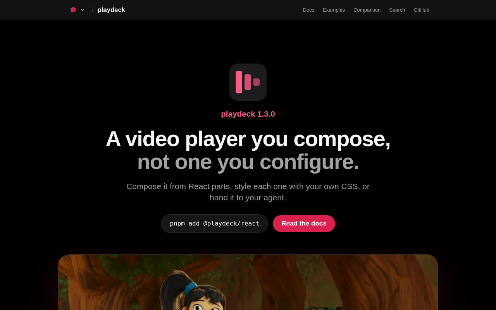

import PlayerProviders from "@components/demos/PlayerProviders";
import BarChart from "@components/BarChart.astro";

TLDR: [Playdeck](https://play.deck.cool) is a headless React 19 media player. One API covers native MP4 and WebM, HLS (VOD and live), YouTube, Vimeo and Wistia. It imports no CSS and renders nothing you didn't compose. Every control checks what the active provider can do. If the provider can't honour a control's command, the control doesn't render. You never see a disabled button for something that was never going to work.

This is part 4 of the [deck.cool series](/posts/deck-cool). Playdeck is the oldest deck, and it started out as Reely, until I found the `@reely` npm scope was taken.

It came out of frustration with video players in React. The answer Playdeck gives is in its API. YouTube, Vimeo and a plain MP4 can't do the same things, and the player should say so.



It was the first project I ran through [Factory](https://github.com/pedrosousa13/factory), stamped the day Factory started. 479 pull requests later, it's at 1.4.

## Table of contents

## Using it

```sh
pnpm add @playdeck/react
```

```tsx
import * as Player from "@playdeck/react";

export const Clip = () => (
  <Player.Root source="https://example.com/clip.mp4">
    <Player.Viewport>
      <Player.Media />
      <Player.Controls>
        <Player.PlayButton />
        <Player.SeekSlider />
        <Player.Time type="current" />
        <Player.FullscreenButton />
      </Player.Controls>
    </Player.Viewport>
  </Player.Root>
);
```

Swap the `source` for a YouTube, Vimeo or Wistia URL, or an `.m3u8`, and nothing else changes. The source decides which provider loads.

## Providers don't have parity

The five providers can't do the same things, and pretending they can only moves the surprise from build time to your users:

- YouTube won't honour a quality choice.
- Vimeo needs a paid plan for chromeless playback.
- YouTube's buffered range can't see buffer that loaded before you arrived.
- Wistia reports no buffered range at all.

Most players hide these gaps behind a uniform API and let the commands fail quietly. Playdeck makes them part of the API instead. Every capability answers one of three ways:

```ts
type Availability =
  | { status: "available" }
  | { status: "unknown"; reason: "not-ready" | "provider-check" }
  | {
      status: "unavailable";
      reason:
        | "browser"
        | "provider"
        | "provider-plan"
        | "provider-build"
        | "source"
        | "policy";
    };
```

The reason is part of the answer. `provider-plan` means your Vimeo account can't do it, and `browser` means this browser can't. I measured each difference that matters against the real SDK instead of trusting its docs.

The controls read this directly:

```tsx
export const FullscreenButton = props => {
  const status = usePlayerState(s => s.capabilities.fullscreen.status);
  if (status !== "available") return null;
  // ...
};
```

There's one exception. `LiveIndicator` reports that a stream is live but offers no command, so where the live edge is unavailable it stays as a non-interactive badge.

Here's a player with the same control bar on both YouTube and Vimeo. It includes a quality menu, a speed menu and picture-in-picture. Under it, the player lists what the active provider says it can do. Press play on each and compare:

<PlayerProviders client:visible />

## You only download your provider

`@playdeck/react` is the only package you install, and it loads each provider lazily once source detection knows which one the source needs. A page playing MP4 ships no YouTube, Vimeo, Wistia or hls.js code.

<BarChart
  title="What a page downloads, by what it plays (gzip, React excluded)"
  unit=" KB"
  rows={[
    { label: "Wistia", value: 40.2, highlight: true },
    { label: "YouTube", value: 41.0, highlight: true },
    { label: "MP4 or WebM", value: 41.7, highlight: true },
    { label: "HLS, Safari and iOS", value: 47.2, highlight: true },
    {
      label: "Vimeo",
      highlight: true,
      parts: [
        { label: "Playdeck", value: 42.8 },
        { label: "@vimeo/player", value: 8.5, muted: true },
      ],
    },
    {
      label: "HLS, Chrome, Firefox",
      highlight: true,
      parts: [
        { label: "Playdeck", value: 47.2 },
        { label: "hls.js", value: 192.4, muted: true },
      ],
    },
  ]}
  caption="Orange is Playdeck. Gray is the provider's own library: @vimeo/player for Vimeo, hls.js for HLS outside Safari."
/>

HLS on Chrome and Firefox is the outlier, and most of that isn't Playdeck. hls.js is 192.4 KB, and Playdeck's HLS adapter over it is 5.5 KB. Lazy loading doesn't make hls.js smaller. It means the other rows never download it, and neither do Safari and iOS, which play HLS natively.

You can switch to `hls.js/light` to save 69.1 KB, and give up subtitles, alternate audio and DRM. The player reports that too. The light build still parses subtitle renditions but never emits them, so before 1.0 its tracks could be counted but never selected. I fixed that in a pass to close honesty gaps before freezing the 1.0 API.

## Building the iframes myself

For YouTube and Vimeo, Playdeck builds the `<iframe>` itself and hands it to the SDK to adopt. That way it controls the referrer policy, the `allow` list and the title. One side effect is that YouTube's iframe API ignores `videoId` and `playerVars` when you hand it an existing frame, so those go on the iframe's URL as query parameters.

The Vimeo iframe has no `sandbox` attribute, and that's a deliberate tradeoff. The only two restrictions that would matter, `allow-scripts` and `allow-same-origin`, are both needed by the Vimeo SDK's postMessage bridge. A sandbox carrying both is close to no sandbox at all, so I wrote the tradeoff down instead of pretending a sandbox helped.

## Styling and accessibility

The primitives are headless, but the structural CSS ships inline. That's position, inset, z-index and the media filling its viewport. A player whose overlays don't stack until you remember to import a stylesheet is broken by default.

Everything visual is yours. Targets default to 44px, the WCAG 2.2 enhanced target size, even with no stylesheet imported. Keyboard shortcuts work across the whole player region, and the arrow keys move the same distance everywhere, including on a focused seek or volume slider. Global shortcut mode is something you opt into, as WCAG 2.1.4 requires for character-key shortcuts. Story tests run axe through Playwright.

## Comparing it

The [comparison page](https://play.deck.cool/docs/guides/comparison/) puts Playdeck next to the alternatives, all bundled by the same Vite build with React excluded. The Playdeck row is an MP4 player with a control bar, five of the seven controls the Media Chrome row has:

<BarChart
  title="MP4 player with a control bar, gzipped, React excluded"
  unit=" KB"
  decimals={2}
  rows={[
    { label: "Playdeck", value: 29.53, highlight: true },
    { label: "Media Chrome", value: 41.82 },
    { label: "Vidstack", value: 89.67 },
    { label: "Video.js 8", value: 199.52 },
  ]}
  caption="Same Vite build for every library. From Playdeck's comparison page."
/>

react-player is much smaller, at 2.97 KB, but it draws no UI of its own and leaves the controls to the browser's native player. Playdeck doesn't do everything. It has no DRM, DASH, playlists, ads or analytics hooks. Chromecast goes through the Remote Playback API, not the Cast SDK.

## Testing against real providers

Most of the suite runs on mock providers and local media. There's also a `@real` suite that plays real YouTube, Vimeo and Wistia embeds, and it used to run every night.

I retired the schedule. On a GitHub-hosted runner, YouTube answers the player request with a 200 and then serves no video at all. The nightly run went red and stayed red, filing an issue every night that said nothing about the code. A check that can't pass is worse than no check. The real-provider suite still exists, but it only runs on demand.

CI installs the real tarballs and type-checks them under every module-resolution mode. It also builds a Next.js app with a client route and a server component route, and drives it in a browser. It prints bundle sizes on every run and never fails on them. Staying lean is a standing goal, not a ceiling the build enforces.

## How Factory built it

Playdeck was the first [Factory](https://github.com/pedrosousa13/factory) project, stamped the day Factory started. It's also the one that's been through the loop longest: 479 merged pull requests and 407 closed issues, with none open right now.

Its milestones read like the project's history: provider hardening, the player state vocabulary, control-bar completeness, security hardening, v1.0.0 (76 issues), 1.1 (92 issues), plugin seams, feature parity and the site.

Playdeck is set up as having an attack surface, so its milestones end with a security sweep, a full OWASP Top 10 pass over the code as it stands. There have been seven so far, from the first hardening milestone through 1.5. The sweeps report and never fix. Their findings come back to me for triage first.

## What's next

Part 5, the last one, is Pagedeck, the static-site framework every deck.cool site runs on.

## Try it

- [Docs](https://play.deck.cool)
- [npm: @playdeck/react](https://www.npmjs.com/package/@playdeck/react)
- [Source](https://github.com/pedrosousa13/playdeck)
