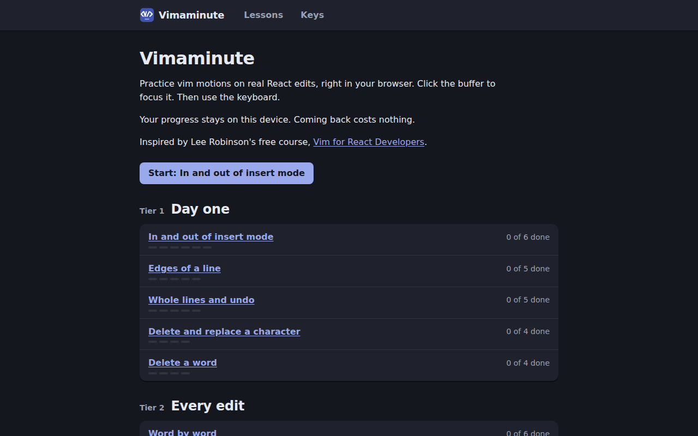
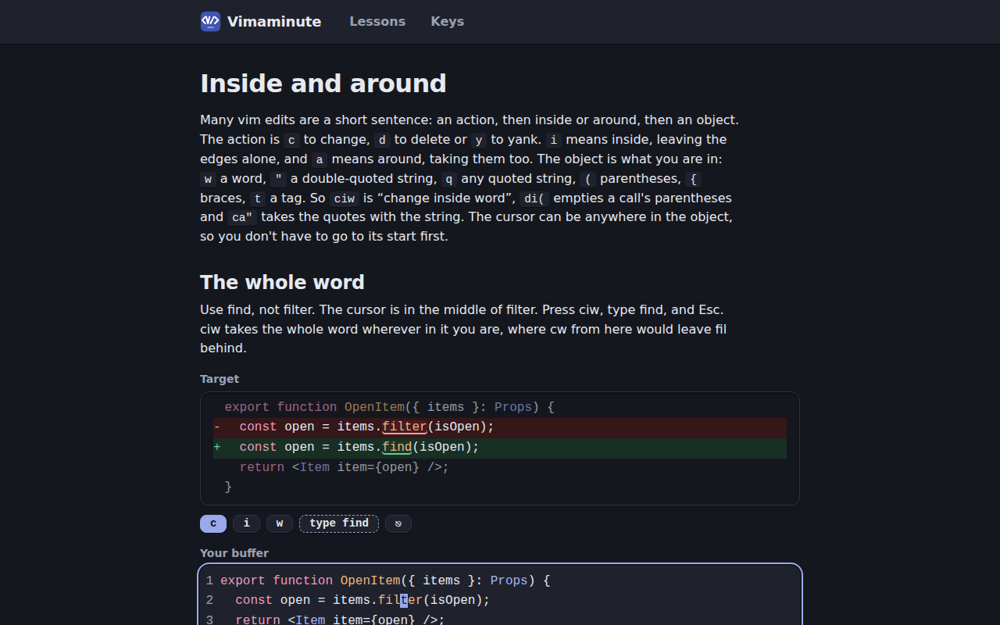
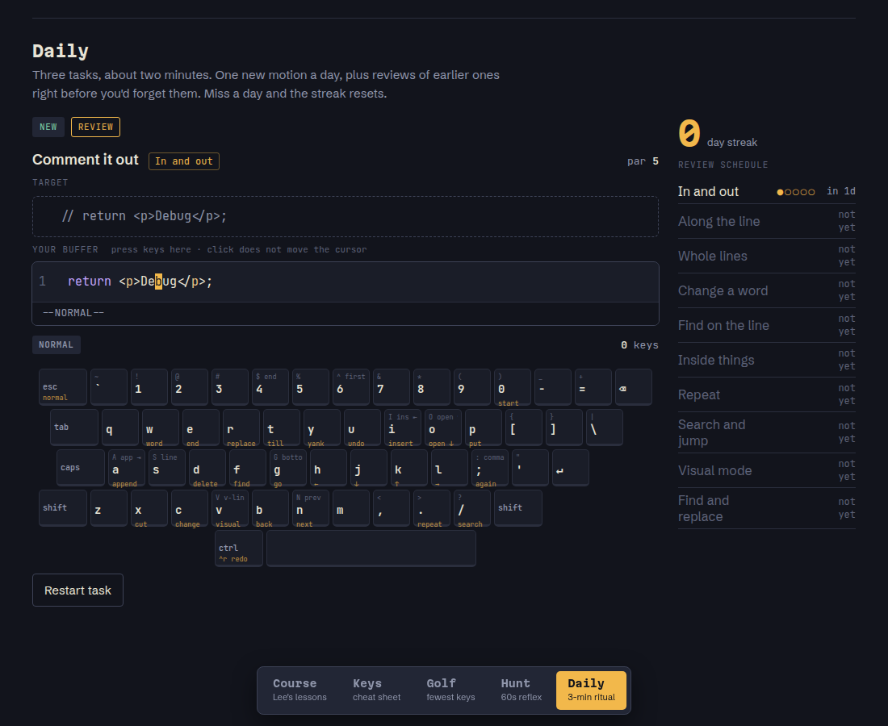

TLDR: [Vimaminute](https://vim.pedrosousa.me) is a vim course that runs in the browser. Every step is a small real React or TypeScript edit in a live editor with vim keys. It notices which motions you struggle with, shows you a faster route when you take the long way, and gives you a short warm-up when you come back after a break. Your progress stays on your device.

It follows the lessons of Lee Robinson's free course, [Vim for React Developers](https://vimforreactdevs.com). I wanted to work through that course interactively, typing the motions instead of reading about them.



## Table of contents

## Why I kept quitting vim

I've given up on vim several times, and always for one of four reasons:

- I was too slow at real work, so I switched back.
- I fell into the config rabbit hole before the motions stuck.
- The drills were boring.
- I forgot everything between sessions.

A course that fixes only one of those doesn't help. Fun drills don't matter if you've forgotten the motions by next week. So Vimaminute tries to handle all four. The edits are real code, so practice looks like work. There's nothing to configure. Each step takes under two minutes. And coming back after a break is part of the design.

## A step is one real edit

Each lesson teaches two or three motions over three or four steps. A step shows a target diff and puts you in a buffer with the cursor already placed:



This one teaches `ciw`. The cursor sits in the middle of `filter`, and the target is `find`. Pressing `cw` from there would leave `fil` behind, which is exactly why `ciw` exists. The step is done when the buffer matches the target, ignoring indentation.

Every motion in a lesson gets practised at least twice, on different code. Each step has a par, the number of keys the planned route takes, so you can tell when you took the long way.

The course has 15 lessons in three tiers:

- **Day one**: insert mode, line edges, whole lines and undo, single characters, words.
- **Every edit**: word motions, `f` and `t`, inside and around, `.` to repeat, counts, shifting lines.
- **Getting around**: search, `gg` and `G`, visual mode, `:%s`, and `%` and `*`.

## Real vim, not a lookalike

The editor is CodeMirror 6 with Replit's `codemirror-vim`. Out of the box it doesn't behave exactly like the editor you'll use after the course, so I patched the parts that differ. `cit` works on JSX elements. `ciq` and `caq` work on any kind of quote, as they do in LazyVim's mini.ai.

The keys page lists where Vim, Neovim and LazyVim differ, so nothing you learn here surprises you there. `S` is one example: LazyVim's flash.nvim takes it over, so the course teaches `cc`.

## It notices where you struggle

Every attempt at a step is evidence for the motions that step teaches. The course records keys over par, time, restarts and skips. It also records detours, which are long runs of `h`, `j`, `k` or `l` where the step taught a faster way.

Each motion gets a score from that evidence, and old evidence fades with a one-week half-life. A motion is new, strong or shaky.

The score changes how much help you get. While any of a step's motions is shaky or new, the player lights the next key at once. Once they're all strong, the hint waits for a two-second pause first.

## A faster route after a detour

When you solve a step the long way, the Done panel shows what you pressed next to a shorter route to the same spot:

```
you: l×24 (24) · faster: f4; (3)
```

To find it, the player simulates finds, word motions, line edges, searches, `G` and `gg`, and counts. It keeps the shortest route that lands exactly where your detour did, and it prefers motions the step teaches.

## Coming back costs nothing

Forgetting between sessions needs its own answer, so the course plans for it. Come back after a day or more, and the course index offers a warm-up. It's up to four steps you've already done, for the motions you struggle with most, weakest first. That's about a minute. Then it drops you back on the step you left. One click or Esc skips it.

Progress is one versioned object in `localStorage`. There's no account and no server, and nothing leaves the browser. To move progress to another device, there's a progress link. It carries the progress in the URL fragment, so it never reaches the server either.

## How it's built

Vimaminute is a static site built with [Pagedeck](https://page.deck.cool), my own framework from the [deck.cool](/posts/deck-cool) family. Lessons are markdown files, and `pagedeck sync` checks every lesson against a schema and fails the build on a bad field. The player is one React island, and the index and keys pages don't load CodeMirror at all.

It's served from Cloudflare with a strict Content Security Policy: scripts only from the site itself, no frames, no forms.

The first version was a throwaway prototype called Vim Dojo, with three game ideas side by side. Golf scored you against par, Hunt showed you a faster way to a target, and Daily ran drills on a Leitner box schedule.



I kept only the course and rebuilt it properly with [Factory](https://github.com/pedrosousa13/factory): a planning session turned it into 27 issues across five milestones, and the loop built them. The whole real version took six days and 49 merged pull requests.

## How Factory built it

Vimaminute was a [Factory](https://github.com/pedrosousa13/factory) project from the first commit. One planning session turned the prototype into a PRD (#1) and 27 issues across five milestones. They grew to about 70 as the work went on:

- **M1 Foundation**: the site, the vim parity patches, lessons from markdown with every step replayed in CI, the on-screen keyboard, the deploy, and four design directions to pick from
- **M2 Curriculum**: the three tiers of lessons, the keys page, a lint for every step's par, and a long tail of "do what Vim does here" fixes
- **M3 Comeback**: struggle scoring, coaching, fading hints, the warm-up and the progress link
- **M4 Launch**: the landing page, security headers, the share image, a real 404 page
- **M5 Spaced review**: still being planned

The project is set up as having an attack surface, so M3 and M4 each ended with a security sweep. From the first commit to the live site took six days and 49 merged pull requests.

## Try it

[vim.pedrosousa.me](https://vim.pedrosousa.me). Click the buffer to focus it, then use the keyboard.
